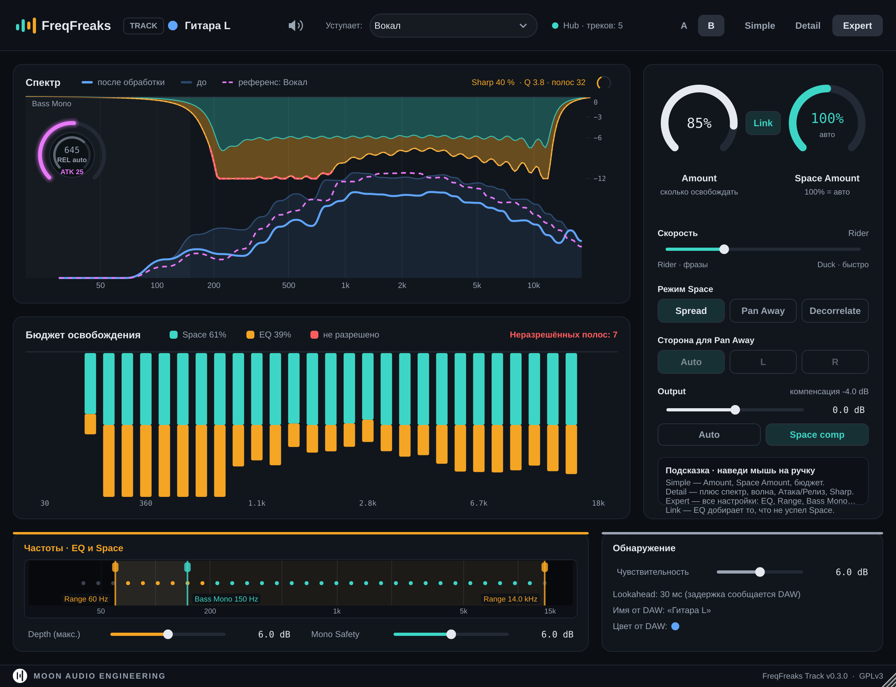
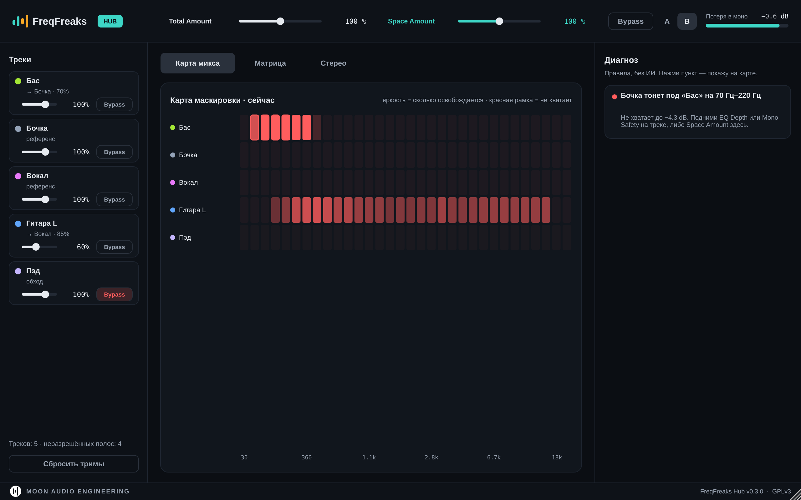
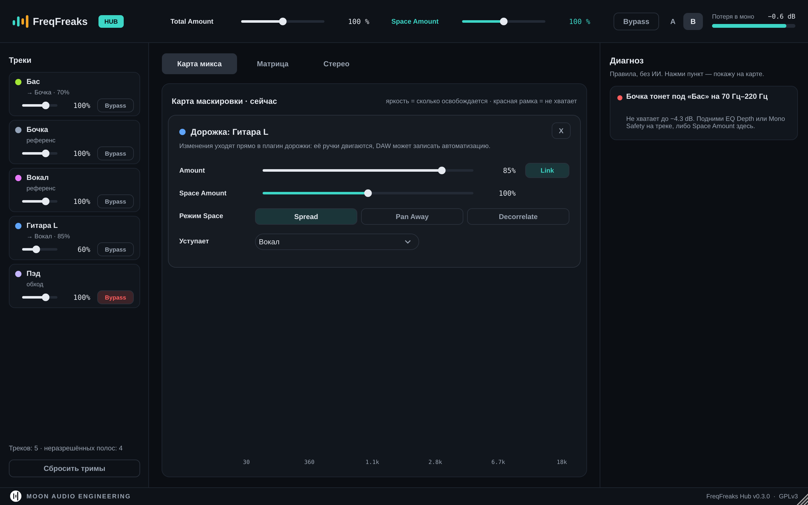

# FreqFreaks

Бесплатный плагин с открытым кодом для сведения: освобождает частоты между инструментами.
**Track** ставится на каждую дорожку и уступает место выбранному референсу.
**Hub** на мастере видит все экземпляры и управляет ими как одним целым.





## Что уже работает (этапы 0 и 1)

- **Связь экземпляров** через общую память: работает и в одном процессе, и между процессами (DAW, которые изолируют плагины). Референс выбирается из списка, без роутинга сайдчейна.
- **Модель слышимой маскировки**: плагин режет только там, где референс реально маскируется, и ровно столько, сколько нужно.
- **Space**: уводит мешающие полосы из центра в стороны (Spread / Pan Away / Decorrelate) с сохранением энергии, с Bass Mono и Mono Safety.
- **EQ**: плавные перекрывающиеся полосы на неподвижных частотах от 40 Гц до 14 кГц — двигаются только их уровни, поэтому без «подводного» звука. Range и Bass Mono — жёсткие границы: за ними срез не больше 0,5 дБ уже на 0,7 от границы.
- **Space сохраняет энергию точно**: сколько ушло из центра, столько пришло в стороны (±0,1 дБ).
- **Компенсация громкости**: Space comp держит громкость постоянной, когда крутишь Space Amount; Output — ручная поправка ±12 дБ и Auto, которая возвращает громкость, потерянную от освобождения.
- **Sharp** — маленькая ручка ширины полос подавления. 0% — ровно как раньше (16 широких полос, ~0,8 октавы; автотест сверяет выход с прежней версией). До 50% — уже, до 32 полос по ~1/3 октавы. Выше 50% — **узкий режим**: подробный анализ (96 полос по ~1/11 октавы) находит, где именно конфликт, и до 8 подвижных узких колоколов (Q 4…16) встают точно туда и плавно едут за ним. Переход без щелчков, а тяжёлый расчёт разложен по нескольким блокам, чтобы не было пиков нагрузки.
- **Прослушка** (иконка динамика у имени трека): Delta — только то, что плагин убрал (всё, только EQ, только Space); вход без обработки; **референс** и **трек + референс**. Звук референса берётся с его FreqFreaks, до фейдера, поэтому слышен и когда трек в соло.
- **Нагрузка**: ~1–3% одного ядра на трек, самый тяжёлый блок при буфере 32 — меньше 20% его времени; автотест падает, если станет тяжелее.
- **Подсказки**: блок «Описание» справа внизу объясняет ручку под мышкой.
- **Частоты в Expert** — маленькое окно эквалайзера: края Range и Bass Mono тянутся мышью, точки показывают полосы плагина и какие из них работают.
- **О плагине** (меню по клику на логотип): разработчик, версия, лицензия с полным текстом и ссылка на исходный код.
- **Размер окна** 60–200%: тяни за правый нижний угол или выбери в меню по клику на логотип («Под экран» — подогнать); размер запоминается. Окно никогда не открывается больше экрана, а если DAW даёт окно другой формы, интерфейс встаёт по центру без полос.
- **Волна подавления** прямо на спектре: точная характеристика Space (бирюзовая) и EQ (янтарная), красная кромка там, где не хватает.
- **Бюджет освобождения**: Space Amount (100% = автоматический выбор плагина) и Link — EQ добирает то, что не сделал Space.
- **Rider ↔ Duck**: от медленного «райдинга» по фразам до быстрого дакинга.
- **Lookahead 30 мс**: трек уступает место заранее, до атаки референса; задержка сообщается DAW.
- **Hub**: Total Amount и Space Amount на весь микс, общий Bypass, сравнение A/B, потеря в моно, карта маскировки, матрица «кто кому уступает», стерео-карта и диагноз по правилам (без ИИ).
- **Hub по каждой дорожке**: трим 0–150% («больше / меньше» поверх Amount дорожки) и Bypass; без Hub дорожки работают как раньше. Двойной клик по дорожке — панель с её Amount, Space Amount, Link, режимом Space и референсом: изменения уходят прямо в плагин дорожки, её ручки двигаются.
- **Сессия**: ID экземпляров и связи сохраняются в проекте; имя и цвет трека берутся из DAW и меняются вместе с ней: стандартным способом VST3 (и тогда, когда DAW присылает их раньше, чем плагин готов — небольшая правка обёртки JUCE в `cmake/PatchJuce.cmake`), а в Studio One — через расширение PreSonus (IContextInfoProvider), потому что стандартным способом Studio One имя не передаёт. Клик по имени или цветной точке — задать своё (оно главнее); в Expert видно, что прислала DAW.

Форматы: VST3, LV2 и Standalone (Linux), VST3, AU и Standalone (macOS), VST3 и Standalone (Windows).

## Ещё не сделано

- Режимы Harmonic и HQ, защита атак (HPSS) и формант, Fair share, Learn по всей песне — этап 2.
- Распознавание инструментов и ИИ-ассистент (Диагноз / Исправь) — этап 3.
- CLAP и AAX.
- Проверка в реальных DAW. Пока плагины проверены автотестом, который хостит VST3 так же, как DAW, но не в Reaper, Ableton, Logic или Bitwig.
- Код общей памяти для Windows и macOS написан, но не собирался и не проверялся.

## Сборка

Нужны CMake 3.22+ и компилятор C++17. JUCE 8.0.9 скачивается автоматически.

```bash
cmake -S . -B build -DCMAKE_BUILD_TYPE=Release
cmake --build build --config Release
```

Свой checkout JUCE: `-DFREQFREAKS_JUCE_PATH=/path/to/JUCE`.
Только ядро DSP без JUCE: `-DFREQFREAKS_BUILD_PLUGINS=OFF`.

На Linux нужны пакеты:

```bash
sudo apt install libasound2-dev libx11-dev libxrandr-dev libxinerama-dev libxcursor-dev \
                 libxext-dev libfreetype-dev libfontconfig1-dev libgl1-mesa-dev
```

Готовые плагины лежат в `build/plugins/FreqFreaksTrack_artefacts/Release/` и `build/plugins/FreqFreaksHub_artefacts/Release/`.

## Как пользоваться

1. Поставь **FreqFreaks Track** на дорожки, которые должны уступать место (гитары, пэды, бас), и на референсы (вокал, бочка).
2. На уступающей дорожке выбери в «Уступает:» трек, которому нужно освободить место.
3. Крути **Amount** (сколько освобождать) и **Space Amount** (какую часть делает стерео-раздвижка). С включённым **Link** EQ сам добирает остаток.
4. Поставь **FreqFreaks Hub** на мастер: там общие ручки, сравнение A/B и карта конфликтов.

## Тесты

```bash
cd build && ctest --output-on-failure
```

- `core` — модульные тесты ядра DSP и шины (135 проверок).
- `host` — загружает собранные VST3 так же, как DAW: задержка, освобождение на 2 кГц, ручки Hub, референс в другом процессе.

`freqfreaks_snapshot <папка>` рендерит настоящие окна Track и Hub в PNG после короткого демо-микса.

## Устройство

```
core/      ядро DSP без JUCE: анализ, маскировка, бюджет, полосы, Space/EQ, общая шина
plugins/   Track и Hub на JUCE 8, общий внешний вид и виды полос
tests/     модульные тесты, хост-тест VST3, рендер скриншотов
```

## Разработчик

Moon Audio Engineering.

## Лицензия

GPL-3.0-or-later, см. [LICENSE](LICENSE).
